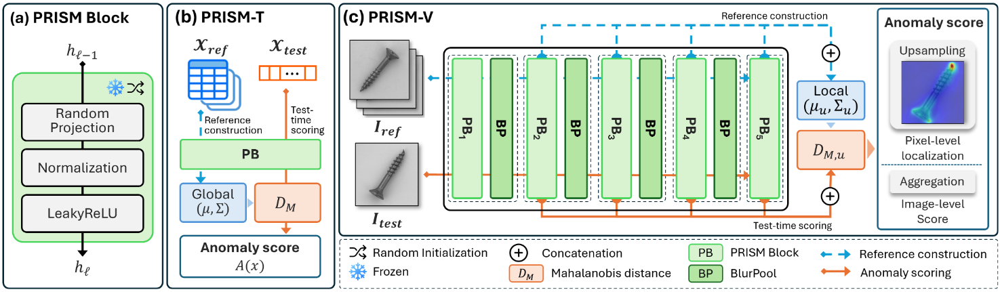
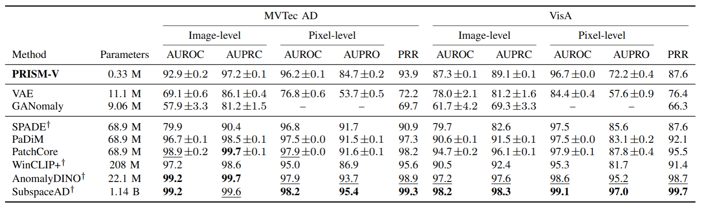

# How Far Can Anomaly Detection Go Before Learning? Random Neural Features from Tables to Pixels

**PRISM Framework**



Authors: *Hyojun Yi, Geunyoung Kim, Hogeon Seo, and Seunghyoung Ryu*

paper: How Far Can Anomaly Detection Go Before Learning? Random Neural Features from Tables to Pixels


## Introduction

This repository contains the implementation of **PRISM-V**, the visual anomaly detection module of PRISM. PRISM-V investigates the effectiveness of untrained convolutional neural representations for image-level anomaly detection and pixel-level anomaly localization. 
By combining randomly initialized neural features with statistical anomaly scoring, PRISM-V performs anomaly detection without neural network weight optimization.

## Data

### MVTec AD

Download `mvtec_anomaly_detection.tar.xz` from the [official MVTec AD website](https://www.mvtec.com/company/research/datasets/mvtec-ad) and place it in the project root. The `bash run mvtec ad` command below prepares the dataset automatically if needed.

### VisA

The `bash run visa` command below automatically downloads and prepares VisA if needed.

Prepared datasets are stored in the following directories:

```text
data/
├── mvtec/
└── visa/
```


## Running the experiments

Run the following commands from the project root.

### Model Preparation

Run the MVTec AD experiment:

```bash
bash run mvtec ad
```

Run the VisA experiment:

```bash
bash run visa
```

### Evaluation

After fitting both datasets, evaluate MVTec AD and VisA together with one command:

```bash
bash run evaluation
```

The evaluation results can also be reviewed in [results/comparison.md](results/comparison.md).

## Results



Image-level anomaly detection and pixel-level localization performance on MVTec AD and VisA. All values are reported in %. PRR denotes the mean ratio of each available score to the best-performing value for the corresponding category and metric. PRISM-V demonstrates that even a compact neural network with randomly initialized weights can achieve meaningful anomaly localization performance.


## Project structure

```text
prism_v_main_repo/
|--- README.md
|--- requirements.txt
|--- run                           # Experiment and evaluation entry point
|--- datasets/
|    |--- loader.py
|    |--- dataset_prepare_mvtec.py
|    \--- dataset_prepare_visa.py
|--- models/
|    |--- prism_v.py                # PRISM-V encoder
|    \--- prism_head.py             # Gaussian anomaly detection head
|--- scripts/
|    |--- cli.py
|    |--- main_spec.py
|    |--- train.py
|    \--- experiment_state.py
|--- evaluation/
|    |--- evaluate.py
|    |--- metrics.py
|    \--- score_io.py
|--- data/                         # Prepared datasets
|    |--- mvtec/
|    \--- visa/
\--- results/                      # Experiment outputs
     |--- mvtec/
     |--- visa/
     \--- comparison.md            # Evaluation report for both datasets
```


## Acknowledgements

This work was partially supported in part by the IITP (Institute of Information & Communications Technology Planning & Evaluation) - ICAN (ICT Challenge and Advanced Network of HRD) grant funded by the Korea government (Ministry of Science and ICT) (IITP-2026-RS-2024-00436528), and in part by the National Research Foundation of Korea(NRF) grant funded by the Korea government(MSIT) (RS-2024-00454514)

## License and Citation

This repository is made publicly available for non-commercial academic research and reproducibility purposes. The source code may be downloaded, executed, and modified for such purposes. Commercial use and redistribution require prior written permission from the rights holder.
The underlying technology is subject to a pending patent application. No patent license is granted under this notice.

The MVTec AD and VisA datasets are not redistributed with this repository and remain subject to their respective licensing terms.

Citation information will be added upon publication.
